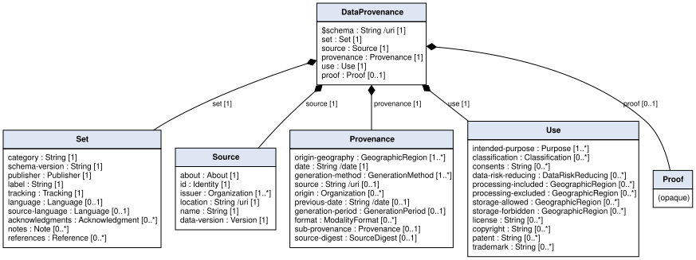

# Provenance Schema {#provenance-schema}

The property tables of this section give, for each type, its members with their type, cardinality, and description.
They are generated from the JADN encoding of the information model (section [sec](#jadn-encoding)),
which is generated from the JSON schema, the normative definition of the format.

The Data Provenance Standards record metadata elements in three segmented categories: Source, Provenance, and Use.

[fig](#fig:metadata), generated from the JSON schema like the tables, shows the root type with the type of each of its members.

{#fig:metadata}

The property tables first define metadata about the specification itself,
then describe how a record is made of the 3 primary metadata elements.
The three segmented categories (Source, Provenance, and Use) are comprised of various
metadata element input fields. Each field is described in more detail in section [sec](#provenance-data-model-encoding).
